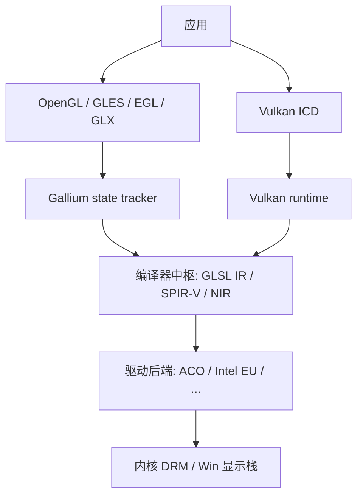
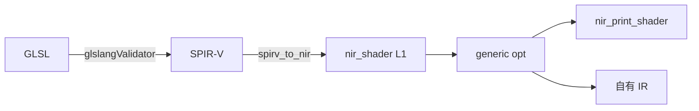

# Mesa 架构、编译器与 NIR Dump

本文对应仓库中的 Mesa 26.2.5 源码（`third_party/mesa`，官方 tarball），以及阶段 0 交叉编译出的 `spirv2nir.exe` 对最小 Vulkan fragment 的 `nir_print_shader()` 输出。

---

## 1. Mesa 是什么

Mesa 是开源 3D 图形栈：把 OpenGL / GLES / EGL / Vulkan / OpenCL 编译并提交到 GPU。上游仓库：https://gitlab.freedesktop.org/mesa/mesa

当前工作区里的副本：

- 版本：`26.2.5`（`third_party/mesa/VERSION`）
- 构建系统：Meson + Ninja
- 运行时主体：C / C++
- Python：构建期代码生成，meson 在编译前跑脚本产出 `.c/.h`

本项目交叉编译时关掉了 OpenGL、Vulkan ICD、Gallium 驱动、LLVM，只留下 `src/compiler` + `src/util`，产物是离线工具 `spirv2nir.exe`。

---

## 2. 整体架构

逻辑上分四层：应用 API、状态跟踪 / ICD、编译器中枢、硬件后端。



### 2.1 源码目录对照

| 目录 | 职责 |
|------|------|
| `src/compiler/` | 着色器编译器：GLSL、SPIR-V、NIR |
| `src/gallium/` | OpenGL 的可插拔驱动框架（softpipe、iris、radeonsi 等） |
| `src/vulkan/` 与 `src/*/vulkan` | Vulkan 公共代码 + 各厂 ICD（radv、anv 等） |
| `src/amd` `src/intel` `src/freedreno` `src/nouveau` `src/panfrost` 等 | 厂商后端：ISA、命令流、NIR lowering |
| `src/egl` `src/glx` `src/gbm` | 窗口系统 / 显示 |
| `src/util` | ralloc、hash、blob、日志等公共底座 |
| `include/` | 对外 Khronos 头文件 |
| `docs/` | 上游文档 |

NIR 是前端和后端的汇合点：GLSL / SPIR-V / CLC 都进 NIR，各 GPU 后端再从 NIR 往下 lower。同一套 `nir_opt_algebraic`、DCE、CSE 所有驱动共用。

### 2.2 语言与构建

`meson.build` 声明项目语言为 C11 / C++17。Python 脚本挂在 meson `custom_target` 上，编译前生成表驱动代码。

典型生成器：

| 脚本 | 产出 | 用途 |
|------|------|------|
| `src/compiler/nir/nir_opcodes.py` | `nir_opcodes.c/h` | ALU opcode 表 |
| `src/compiler/nir/nir_intrinsics.py` | intrinsic 枚举与 builder | `@load_deref` 这类 intrinsic |
| `src/compiler/nir/nir_opt_algebraic.py` | `nir_opt_algebraic.c` | 代数优化规则 |
| `src/compiler/spirv/spirv_info_gen.py` + `spirv.core.grammar.json` | `spirv_info.c/h` | SPIR-V opcode / 枚举 |
| `src/compiler/builtin_types.py` | `builtin_types.c/h` | GLSL 类型表 |

opcode、SPIR-V grammar、代数规则体量大、变更频繁，用 Python 做「表 → C」的编译器。

---

## 3. 编译器部分

编译器集中在 `src/compiler/`。对当前离线工具，路径钉死为：

```text
.vert/.frag/.comp  --glslangValidator -V-->  .spv
.spv               --spirv_to_nir()------>  nir_shader  (generic NIR / L1)
```

GLSL 先经 glslang 变成 SPIR-V，再进 Mesa；本项目不走 `glsl_to_nir`。



### 3.1 子目录

| 路径 | 角色 |
|------|------|
| `src/compiler/spirv/` | SPIR-V 前端（VTN）。`spirv_to_nir.c`、`vtn_alu.c`、`vtn_cfg.c`、`vtn_variables.c` 等把 `.spv` 字码建成 `nir_shader` |
| `src/compiler/nir/` | 硬件无关 IR 与优化 pass。数据结构在 `nir.h`，打印机在 `nir_print.c` |
| `src/compiler/glsl/` | 老的 GLSL → NIR 路径，完整 OpenGL 驱动使用。本项目 `with_gallium=false`，未编入 `spirv2nir.exe` |
| `src/compiler/clc/` | OpenCL C 前端，依赖 LLVM / SPIRV-Tools。本项目关闭 |
| `src/compiler/glsl_types.*` `shader_enums.*` `shader_info.h` | 类型、stage 枚举、`shader_info` 元数据 |

`spirv2nir` 可执行文件定义在 `src/compiler/spirv/meson.build`：链 `libvtn` + `libnir` + `libcompiler` + `libmesa_util`。

### 3.2 停在 L1 的含义

generic NIR（L1）保留：

- 函数 inline、SSA、通用 opt（DCE / CSE / algebraic / constant folding 等）
- 变量 + deref 形式的 IO

本项目明确不做：

- `nir_lower_io`（变量 IO 变成 `load_input` / `store_output`）
- source mods
- `nir_convert_from_ssa`
- 各驱动 `*_nir_lower_*`

`nir_shader_compiler_options` 按能力全集填写，硬件能做的 opcode 保留。

### 3.3 阶段 0 构建要点

Linux 上 MinGW 交叉，产出 Windows PE：

- cross file：`third_party/mesa/mingw-w64.ini`
- 配置：`-Dtools=nir`，关闭 gallium / vulkan / llvm / opengl / zlib
- 补丁：
  - `spirv2nir.c` 用 `fopen/fread` 替代 POSIX `mmap`，才能在 Windows 上读 `.spv`
  - `meson.build` 的 `with_gfx_compute` 在 `tools=nir` 时为真，否则 `libnir` 编成 `nir_stub.c`，链接缺符号

产物：当前工作区 `/out/spirv2nir.exe`（PE32+ x86-64）。Wine 下可 dump NIR 文本。

---

## 4. NIR 对象树

NIR 的核心类型在 `src/compiler/nir/nir.h`。打印机 `nir_print_shader()`（`nir_print.c`）按固定顺序遍历这棵树。

```text
nir_shader
├── info                         shader_info：stage、哈希、IO 统计、subgroup
├── variables[]                  nir_variable：in / out / ubo / ssbo / ...
├── functions[]                  nir_function
│   └── impl                     nir_function_impl
│       └── blocks[]             CFG，带前驱 / 后继
│           └── instrs[]         双向链表
│               ├── alu          fadd / fmul / ...
│               ├── deref        deref_var / deref_struct / deref_array
│               ├── intrinsic    @load_deref / @store_deref / ...
│               ├── load_const
│               ├── tex / phi / jump / undef
│               └── dest: nir_def   SSA 值（%id, bit_size, num_components）
└── options                      nir_shader_compiler_options（dump 默认不打印）
```

遍历顺序与主验收对齐：函数声明序 → 块列表序 → 指令列表序。SSA id 与 `nir_print_shader` 同一套编号：按定义出现顺序从 `%0` 起。

指令文本约定：

- 无 `@` 的名字：ALU opcode，例如 `fmul`
- `@` 前缀：intrinsic，例如 `@load_deref`
- `load_const`：立即数指令
- `deref_var`：对 `nir_variable` 取地址
- `return`：`nir_jump_instr`

---

## 5. 一份真实 dump 的逐行解释

源 shader（`shaders/min.frag`）：

```glsl
#version 450
layout(location = 0) in vec4 v_color;
layout(location = 0) out vec4 o_color;
void main() {
    o_color = v_color * vec4(0.5);
}
```

`glslangValidator -V` 得到 `shaders/min.frag.spv`，Wine 跑：

```text
wine64 out/spirv2nir.exe shaders/min.frag.spv
```

完整输出：

```text
shader: MESA_SHADER_FRAGMENT
source_blake3: {0xa558c403, 0x69d60cbd, 0x679d76f7, 0x89111b37, 0x6ffba2f7, 0x050d756c, 0xd93405d8, 0xac8e8768}
name:
max_subgroup_size: 128
min_subgroup_size: 1
origin_upper_left: true
decl_var shader_in INTERP_MODE_NONE none vec4 v_color (VARYING_SLOT_VAR0.xyzw, 0, 0)
decl_var shader_out INTERP_MODE_NONE none vec4 o_color (FRAG_RESULT_DATA0.xyzw, 0, 0)
decl_function main () (entrypoint)

impl main {
    block b0:  // preds:
    32    %0 = deref_var &v_color (shader_in vec4)
    32x4  %1 = @load_deref (%0) (access=none)
    32x4  %2 = load_const (0x3f000000, 0x3f000000, 0x3f000000, 0x3f000000) = (0.500000, 0.500000, 0.500000, 0.500000)
    32x4  %3 = fmul %1, %2 (0.500000, 0.500000, 0.500000, 0.500000)
    32    %4 = deref_var &o_color (shader_out vec4)
               @store_deref (%4, %3) (wrmask=xyzw, access=none)
               return
               // succs: b1
    block b1:
}
```

### 5.1 Shader 头 → `nir_shader.info`

| dump 行 | 字段 | 含义 |
|---------|------|------|
| `shader: MESA_SHADER_FRAGMENT` | `info.stage` | 片元着色器 |
| `source_blake3: {...}` | `info.source_blake3` | 源 SPIR-V 内容哈希 |
| `name:` | `info.name` | 空，glslang 未写 shader 名 |
| `max_subgroup_size` / `min_subgroup_size` | subgroup 范围 | 硬件无关默认值 |
| `origin_upper_left: true` | 片元坐标系 | Vulkan 约定 |

`num_inputs` / `uniforms` / `scratch` 为 0 时打印机静默，dump 里不出现。

### 5.2 变量 → `nir_variable`

```text
decl_var shader_in  ... vec4 v_color (VARYING_SLOT_VAR0.xyzw, 0, 0)
decl_var shader_out ... vec4 o_color (FRAG_RESULT_DATA0.xyzw, 0, 0)
```

| 片段 | 含义 |
|------|------|
| `shader_in` / `shader_out` | `nir_variable_mode` |
| `vec4` | GLSL 类型 |
| `VARYING_SLOT_VAR0` | `layout(location=0) in` 映射到 Mesa 语义槽 |
| `FRAG_RESULT_DATA0` | `layout(location=0) out` 映射到颜色附件 0 |
| `.xyzw` | 四个分量都活着 |
| `INTERP_MODE_NONE` | 尚未做插值 lowering，符合 L1 |

GLSL 的 `in` / `out` 在 L1 仍是变量。读写走 deref，尚未变成 `load_input` / `store_output`。

### 5.3 函数与 CFG

```text
decl_function main () (entrypoint)
impl main {
    block b0:  ...
    block b1:
}
```

对应 `nir_function "main"`（`is_entrypoint`）→ `nir_function_impl` → CFG。

- `b0`：入口块，指令都在这里
- 末尾 `return` 的后继是空的 `b1`（函数终结块，NIR 惯例）
- `preds:` 为空：入口没有前驱

### 5.4 指令与 SSA

`b0` 里的指令与 `nir_instr` 类型一一对应：

| dump | 类型 | 含义 |
|------|------|------|
| `%0 = deref_var &v_color` | `nir_deref_instr` | 取输入变量地址 |
| `%1 = @load_deref (%0)` | `nir_intrinsic_instr` | 从该地址读 vec4 |
| `%2 = load_const (0x3f000000 x4)` | `nir_load_const_instr` | 立即数 0.5（IEEE `0x3f000000`） |
| `%3 = fmul %1, %2` | `nir_alu_instr` | 向量乘法 |
| `%4 = deref_var &o_color` | `nir_deref_instr` | 取输出变量地址 |
| `@store_deref (%4, %3)` | `nir_intrinsic_instr` | 写入输出 |
| `return` | `nir_jump_instr` | 结束 |

SSA 前缀是 **bit size × components**：

- `32    %0` / `%4`：32-bit，1 个分量（deref / 指针）
- `32x4  %1` / `%2` / `%3`：32-bit × 4（`vec4`）

`fmul` 右边的 `(0.500000, ...)` 是打印机把常量源内联显示，SSA 源仍是 `%2`。

`@store_deref` 无目标 SSA：副作用指令，不定义值。`wrmask=xyzw` 表示四个分量都写。

源 GLSL `o_color = v_color * vec4(0.5)` 在 NIR 里就是：deref 读 → 乘立即数 → deref 写。

### 5.5 从 dump 能确认的层次

这份 shader 停在 generic NIR / L1：

- 值是 SSA
- IO 仍是变量 + deref
- 只有 `fmul` 这种通用 ALU
- 没有 `nir_lower_io` 之后的 `load_input`
- 没有驱动后端 ISA

后续自有 IR 的主验收：对自有 IR 再打印，文本与这份 `nir_print_shader()` dump 的 `diff` 为空。要对齐的就是这棵树：shader 头、变量、函数、块顺序、指令顺序、SSA 编号、opcode 名、src/dst。

---

## 6. 和本项目的关系

计划书：当前工作区 `/ .monkeycode/specs/nir-offline-exporter/tasklist.md`

数据流：

```text
.spv  --spirv_to_nir()-->  nir_shader (L1)
                               |
                               +--> nir_print_shader()              --> a.nir.txt
                               |
                               +--> 遍历 --> 自有 IR --> 自有打印机 --> b.nir.txt
                               |                 |
                               |                 +--> JSON
                               |                 +--> 自有二进制
                               |
                               diff a.nir.txt b.nir.txt  == 空
```

遍历入口永远是内存里的 `nir_shader`，不解析 `nir_serialize()` blob。

阶段 0 已完成：Wine 下 `spirv2nir.exe` 能对 `shaders/min.frag.spv` 打出第 5 节这份 dump。下一阶段在 `spirv_to_nir()` 之后插入固定 generic pass 列表，再以 dump 文本作为黄金对照。
